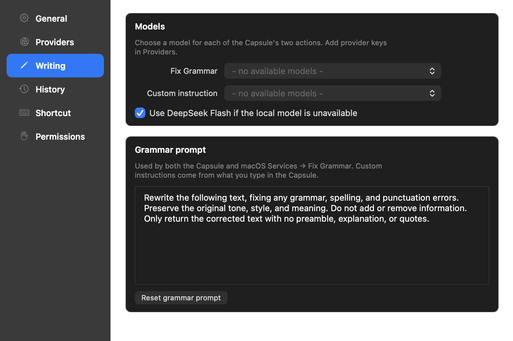

<h1>Companion</h1>

<p>Select text in any Mac app, run a writing command, and replace it in place.<br>
Use your own cloud API key or a local model.</p>

<p><strong>Version 0.3.0</strong> · macOS 13+ · Apple Silicon & Intel</p>

<p>
  
  
  
  
</p>

<p><a href="https://github.com/madebysan/companion/releases/latest">Download Companion</a></p>


Companion is a menu bar app for quick writing tasks in Mail, Notes, Notion, Slack, browsers, code editors, and most places where you can select or enter text. Its small glass capsule offers two actions: fix grammar or write an instruction.

## How it works

Select text in another app and press `Cmd + Shift + E`. Press Return or click the grammar icon to fix the text. Press Tab or click the pencil to type an instruction such as `make this warmer and shorter`, then Return to run it. Companion uses the model configured in Settings, replaces the selection, and keeps the result on your clipboard. Loading and completion use a small glass indicator that disappears when finished.

If nothing is selected, use the instruction field to create new text. Escape returns from the field to the capsule; Escape again closes it. Open Settings through the menu bar or `Cmd + ,`. Writing settings preserve your grammar prompt and model choices; retired presets are kept in a recovery export.

## Models and privacy

Fix Grammar and custom instructions default to paid DeepSeek V4.1 Flash through direct OpenRouter, with reasoning disabled for quick rewrites. Settings → Writing contains their model choices and the grammar prompt. The Capsule and macOS Services use the same grammar configuration. Settings → Providers can reapply the recommended model to both operations without changing the prompt. Local fallback uses this same inexpensive route, never an arbitrary configured frontier model.

Optional routes include LM Studio, the legacy fal gateway, OpenAI, Anthropic, and DeepSeek. The remote model catalog uses direct OpenRouter and refreshes when it is over 24 hours old and the Providers pane opens. A failed refresh preserves the saved catalog.



The former saved-action presets and editor have been retired. Your grammar prompt/model and custom-instruction route migrate to the focused Writing settings. Old presets are exported to a readable JSON recovery file before their preferences are removed; Writing includes a button to reveal that file. If the export fails, old preferences remain intact.

There is no Companion server, account, analytics, or telemetry. LM Studio requests stay on your Mac. Cloud requests send the selected text and instruction directly to the provider route you chose. Provider keys are stored in macOS Keychain. Existing preference keys are removed only after secure storage succeeds; a migration failure leaves the old value recoverable and reports an error.

Companion uses the target editor's native Paste operation so its normal Undo command applies. The rewrite remains on the clipboard after Undo. A changed or unverifiable target, or an incomplete model response, leaves the original text untouched and provides the generated text for manual recovery. Undo depends on the receiving editor supporting normal paste undo.

History saves run off the UI thread, with one file per result. The latest 500 entries are displayed; older entries and previous history archives remain on disk. Clear History moves current records to a recovery archive. History contains results and routing metadata, not the original selection or image bytes.

## Install

1. Download the DMG from [Releases](https://github.com/madebysan/companion/releases/latest).
2. Drag `Companion.app` to Applications and open it from the menu bar.
3. Choose a provider during onboarding or configure one later in Settings.
4. Grant Accessibility and Input Monitoring when macOS asks, then relaunch Companion.

Accessibility lets Companion copy a selection and paste the result. Input Monitoring lets the shortcut work while another app is focused. If macOS keeps an old permission entry after an update, remove Companion from both permission lists, add it again, and relaunch.

## Build from source

```bash
git clone https://github.com/madebysan/companion.git
cd companion
swift build -c release --package-path Companion --arch arm64 --arch x86_64
./script/build_and_run.sh --verify
```

To produce a signed DMG on a configured development Mac, run `./script/build_dmg.sh --notarize`. This notarizes and staples the app and disk image, verifies Gatekeeper acceptance, and copies the DMG to the Desktop. Packaging does not replace the installed app. Existing versioned artifacts are never overwritten.

Companion requires macOS 13 or later on Apple Silicon or Intel. LM Studio and cloud provider keys are optional; at least one local or remote model route is required to generate text.

## Tech stack

Development notes: [interface rules](DESIGN.md).

For an isolated local preview, run `./script/build_and_run.sh --preview`.

- Swift and AppKit
- Swift Package Manager
- [HotKey](https://github.com/soffes/HotKey) for global shortcuts
- LM Studio and OpenAI-compatible chat routes
- Anthropic Messages API for direct Claude support

## License

[MIT](LICENSE)

Made by [santiagoalonso.com](https://santiagoalonso.com)
