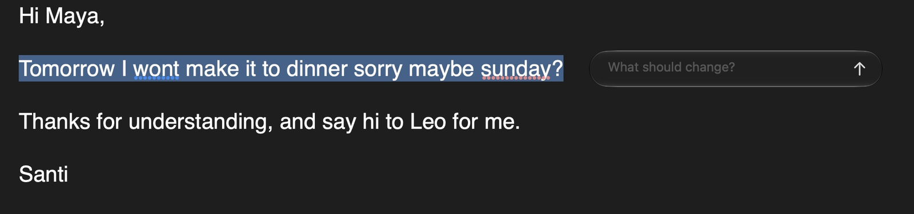

<h1>Companion</h1>

Select text. Say what you want changed. Keep writing.

<strong>Version 0.4.1</strong> · macOS 13+ · Apple Silicon & Intel

  
  
  

<a href="https://github.com/madebysan/companion/releases/latest">Download Companion</a>

A small menu bar app for fixing grammar, rewriting, translating, and summarizing text where you already work. No separate chat window to copy things back from.

## One shortcut, two choices

Select text and press **⌘⇧E**. Fix grammar immediately, or type an instruction: “make this warmer,” “translate to Spanish,” “summarize in three bullets.”

The result replaces your selection and stays on the clipboard. Your editor's normal **⌘Z** undoes the paste. If Companion can't safely verify the selection, it leaves your text alone and offers the result for manual copying.

Prefer typing? Skip the icons with **Settings → General → Open with → Instruction field**. With nothing selected, write something new at the cursor.

## Search when you need it

Add **“use web search”** to your instruction to look things up. Sources stay in History, not in the inserted text. Otherwise, no search runs.

Search adds cost and delay, and sends context to a search provider. Review important claims; AI output isn't guaranteed accurate.

## Bring your own model

Use a cloud API key or a local model through LM Studio. New installs pair Gemini Flash Lite for instructions with DeepSeek Flash for grammar through OpenRouter.

Keys live in macOS Keychain. No Companion backend or analytics. Cloud usage is billed separately; results and history stay saved on your Mac.

## Get started

Download the signed, notarized DMG, drag Companion into Applications, configure a provider, and grant Accessibility and Input Monitoring.

**Upgrading?** Quit the old app before replacing it. Your settings and keys are preserved; permissions may need re-granting.

[Release notes](CHANGELOG.md) · [Report an issue](https://github.com/madebysan/companion/issues) · [MIT license](LICENSE)

Made by [santiagoalonso.com](https://santiagoalonso.com)
